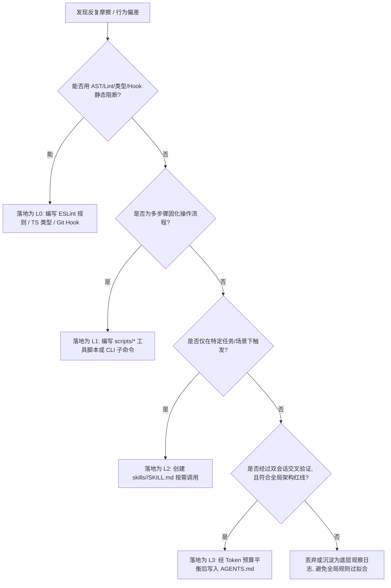

# backpass (kunchenguid/backpass) 机制调研与记忆梯度流架构参考

> **调研代号**: Wayfinder Research #18  
> **目标对象**: [kunchenguid/backpass](https://github.com/kunchenguid/backpass)  
> **核心命题**: Agent 记忆即权重模型（AGENTS.md / CLAUDE.md / Skills as Model Weights），通过会话反思驱动“梯度下降”（Session Reflection as Gradient Descent）。

---

## 1. 调研背景与核心命题

在现代 Agentic 软件工程协作（如 Claude Code, Codex CLI, Cursor, Gemini Antigravity 等）中，开发者与 Agent 共同维护着一系列项目上下文与指导文档（例如 `AGENTS.md`, `CLAUDE.md`, `.cursorrules`, 专属 `SKILL.md`）。然而，传统的记忆维护方式存在两大核心痛点：
1. **人工编写的滞后与猜测性**：开发者依靠主观记忆与碎片直觉去撰写规则，难以精准捕获 Agent 在实际执行中的认知偏差与反复掉坑点。
2. **上下文污染与过拟合膨胀**：随着会话增多，规则越堆越多，不仅侵占稀缺的系统 Prompt Token 预算，还会引发上下文注意力分散（Needle-in-a-Haystack 效应）及规则间冲突。

开源工具 **`kunchenguid/backpass`** 提出了一个极具颠覆性的工程隐喻：
> *"You don't write AGENTS.md. You train it with gradient descent."*  
> （你不需要手动写 AGENTS.md，你应当用梯度下降去训练它。）

本报告深入拆解 `backpass` 的系统架构、数学映射、执行流水线、工程鲁棒性机制，并结合 Yume 的“做梦”（Dream）长期记忆演进框架与团队提出的 **Encode Lessons in Structure** 原则，输出全景对比矩阵与落地演进规划。

---

## 2. 核心隐喻与抽象模型（Conceptual Metaphor & Mapping）

`backpass` 将机器学习模型微调（Fine-Tuning）与反向传播（Backpropagation）的思想映射到了 Agent 记忆系统的自适应进化中：

```
[传统深度学习 (Deep Learning)]          [backpass Agent 记忆工程]
┌──────────────────────────────┐        ┌──────────────────────────────┐
│ Forward Pass (正向传播)       │  ───>  │ Session Execution (会话执行)  │
│ Loss Function (损失函数)      │  ───>  │ Friction / Error Signals     │
│ Model Weights (模型参数权重)  │  ───>  │ AGENTS.md / Rules / Skills   │
│ Gradient Descent (梯度下降)   │  ───>  │ Evidence-Backed Bounded Diff │
└──────────────────────────────┘        └──────────────────────────────┘
```

### 2.1 概念映射体系

| 机器学习概念 | backpass 对应物 | 详细工程语义 |
| :--- | :--- | :--- |
| **Forward Pass (前向传播)** | **日常 Agent 会话执行** | 开发者在 IDE 或 CLI 中与 Agent 协作完成任务，系统依据当前项目规则（Weights）执行推理与工具调用，最终沉淀为 Session Transcripts。 |
| **Loss Signal (损失信号)** | **摩擦、纠偏与运行报错** | Agent 执行中出现的工具调用失败、语法报错、Git 回退、被用户打断指正（"No, don't do that..."）、循环试错等显式与隐式摩擦信号。 |
| **Model Weights (权重参数)** | **项目级记忆规则文件** | 仓库根目录下的 `AGENTS.md`、`CLAUDE.md`、用户全局记忆以及各子领域专属 `skills/*/SKILL.md`。它们是决定 Agent 行动模式的“可调参数”。 |
| **Backward Pass (反向传播)** | **会话轨迹离线溯源与归因** | 通过分析器（Analyzer）对 Distilled Traces 进行信用分配（Credit Assignment），准确定位导致摩擦的“缺陷规则”或“规则真空”。 |
| **Gradient Descent (梯度下降)** | **有界差分提案生成与应用** | 计算更新步长，在严格 Token 预算约束下，输出针对规则文件的添加（Add）、精简重写（Rewrite）、过时剔除（Prune）或技能下沉（Skill Extraction）。 |

---

## 3. 完整执行流水线剖析（Pipeline Architecture）

`backpass` 的架构设计遵循高度解耦的单阶段单模块管道模型，各步骤职责分明，中间状态全部持久化为可验证的中间产物。

```mermaid
flowchart TD
    subgraph Discovery [1. Transcript Discovery]
        LocalHarness[Local Harness Dirs: Claude/Codex/Cursor] -->|Scan & Filter| SessionFilter{Session Matcher}
        RemoteSSH[Remote SSH Nodes via Node script] -->|Fetch Remote| SessionFilter
        SessionFilter --> ClassifiedSessions[Classified Session Store]
    end

    subgraph Distillation [2. Loss Distillation]
        ClassifiedSessions --> DeterministicDistiller[Deterministic Distiller (No-LLM)]
        DeterministicDistiller -->|96-99% Token Compression| DistilledTraces[Distilled Interaction Traces]
    end

    subgraph Analysis [3. Loss Calculation]
        DistilledTraces --> AcpxAdapter[acpx Harness Runner]
        AcpxAdapter --> AnalyzerLLM[Analyzer Models]
        AnalyzerLLM --> GapLedger[Observed Friction & Gap Ledger]
    end

    subgraph Proposal [4. Proposal Generation]
        GapLedger --> Synthesizer[Synthesizer Engine]
        Synthesizer -->|Dual-Session Verification| CredentialCheck{Cross-Validated?}
        CredentialCheck -->|Yes| BudgetEnforcer[Token Budget & Skill Splitter]
        BudgetEnforcer --> StagedProposal[Staged Proposal + Surface Hash]
    end

    subgraph Apply [5. Human Review & Apply]
        StagedProposal --> WebUI[lavish-axi Review WebUI]
        StagedProposal --> TerminalCLI[CLI --no-ui Interactive]
        WebUI -->|Human Approval| ApplyGate[backpass apply]
        TerminalCLI -->|Human Approval| ApplyGate
        ApplyGate -->|Write Update| Weights[AGENTS.md / CLAUDE.md / Skills]
    end
```

### 3.1 阶段一：会话发现与分类（Transcript Discovery）
- **跨平台多 Harness 本地扫描**：
  - 自动穿透扫描本地各主流 Harness 历史目录（如 `~/.claude/projects/`, `~/.codex/sessions/`, Cursor 状态库等）。
  - 通过工作区根目录、Git Commit 祖先链与元数据建立严格的 Session-to-Repo 归属映射。
- **SSH 远程节点轻量采集**：
  - 针对在远程 Dev Container / 云端 VPS 运行的会话，通过轻量级无依赖的 Node 一行指令，在远端完成轻度指纹计算后回传，无需在远程部署完整重量级服务。
- **会话分类判定（Session Classification）**：
  - **人机交互会话（Interactive Sessions）**：权重最高，包含真实开发者的 prompt 意图、反复修正与即时反馈。
  - **自动化流水线会话（CI / Codex Batch / No-Mistakes Runs）**：降权或单独分类，防止流水线的机械性失败或自动轮询行为扭曲正常的人类协作规则。

### 3.2 阶段二：无损规则蒸馏（Loss Distillation）
原始会话 Transcript 通常极其庞大（动辄数万至数十万 Tokens），充斥着海量的 Bash stdout、巨幅代码回显、环境诊断信息与重复渲染。若直接灌入 LLM 进行反思，成本高昂且极易引发上下文注意力稀释。
- **96% ~ 99% 确定性纯规则压缩**：
  - `backpass` 在送入 LLM 之前，执行一套**完全不调用模型**的确定性算法：
    1. **Tool Call Shape 提炼**：保留调用的工具名、目标文件、命令核心意图及退出状态码，剥离数千行的成功输出。
    2. **错误保留与截断**：仅对 stderr / 异常 Stacktrace 提取首尾关键签名。
    3. **敏感信息与噪音清洗**：自动脱敏 Token、密钥，剔除进度条 ANSI 转义符。
  - 压缩后的 Distilled Traces 仅保留 Prompt、Response 以及 Tool Call 骨架，体积通常仅为原日志的 1%~4%，保证了后续反思分析的极速与极低 Token 成本。

### 3.3 阶段三：反思分析与摩擦账本（Loss Calculation / Analysis）
- **驱动引擎 `acpx`**：通过本地已经登录并配置好的 `acpx` 命令行透传调用模型，无需在 `backpass` 内硬编码或重复配置 API Key。
- **会话内因分析与摩擦提取**：
  - 对比会话中的每一次“开发者介入更正”：发生了什么？Agent 违背了什么显式原则？还是因为缺少何种环境前置约束？
  - 输出结构化的 `GapLedger`，并记录原文字符级证据索引（Verbatim Quotes & Line Offsets）。

### 3.4 阶段四：提案合成与双会话交叉验证（Proposal Generation）
这是 `backpass` 防止“过拟合”与“记忆膨胀”的核心算法枢纽：
1. **双会话交叉验证凭据（Dual-Session Cross-Validation Credentialing）**：
   - **核心戒律**：单一会话中出现的摩擦，可能仅仅是特定开发者的偶然偏好或瞬时任务噪音。
   - **硬性门禁**：一条新规则提案要获得采纳资格，必须在至少 **两个独立会话（Dual-Session）** 中找到互相印证的摩擦证据。单次偶发问题仅作观察记录，不生成写入建议。
2. **严格 Token 预算约束（Token Budget Enforcement）**：
   - 规则文件（`AGENTS.md`）设有严格的 Token 上限硬指标（如 1,500 ~ 2,000 Tokens）。
   - **零和预算守恒**：如果要向全局规则增加新条目，引擎必须同时识别并标记出可精炼重写（Rewrite）或已被废弃淘汰（Prune）的旧规则，保证净 Token 增长可控。
3. **Skill 抽取下沉机制（Skill Extraction Heuristic）**：
   - 当某类摩擦涉及繁琐的多步骤规程、特定调试路径或特定工具集的复杂操作时，引擎判定其**不属于全局元规则**，自动建议将其下沉并抽取为独立的 `skills/<name>/SKILL.md`，实现按需唤醒。

### 3.5 阶段五：人工审核与受门禁写入（Human Review & Apply）
- **只读默认原则（Read-Only by Default）**：
  - `scan`、`distill`、`analyze`、`propose` 阶段具备严格的沙箱与只读约束，杜绝任何对项目代码及规则文件的静默篡改。
  - 整个工具链中，**只有 `backpass apply` 拥有文件写权限**。
- **分析面 Hash 校验（Analysis Surface Hash Validation）**：
  - 提案生成时会对当前规则文件的内容计算 SHA-256 Hash。
  - 在最终 `apply` 执行时，若发现工作区规则文件被外部修改导致 Hash 不一致，立即中止并提示冲突重做，防止幽灵覆盖。
- **人机交互审核双模式**：
  - **GUI 模式**：内置调起轻量级 Web Review UI（`lavish-axi`），提供逐条对比的 Diff 视图、关联的双会话原始证据卡片、实时 Token 预算消耗仪表盘。
  - **CLI 模式**：通过 `--no-ui` 在终端呈现交互式彩色 diff，支持 `y/n/e` 逐项裁决。

---

## 4. 关键边界与工程鲁棒性机制

### 4.1 边界隔离矩阵
| 边界维度 | backpass 机制实现 | 设计意图 |
| :--- | :--- | :--- |
| **读写隔离** | 仅 `apply` 命令具备写权限，其余全阶段无副作用。 | 确保用户在审查确认之前，工作区绝对安全可预测。 |
| **会话分类隔离** | 自动过滤 CI/自动化无监督运行，对交互式人工会话加权。 | 避免自动化批量测试的边缘报错干扰日常协作的规则系统。 |
| **范围作用域** | 区分 Project Scope（项目根目录）与 User Scope（全局用户配置）。 | 确保特定项目的私有规范绝不外溢到用户全局环境。 |

### 4.2 容错与梯队 Fallback 机制
1. **模型梯队与配额熔断**：通过 `acpx` 支持模型阶梯（Agent Ladder）。当遇到云端账单耗尽、限流（Rate Limit）或网络超时，能够捕获状态码并优雅回退到次级可用模型，而不会破坏已完成的中间分析缓存。
2. **断点增量恢复**：会话发现与提炼结果均有本地持久化缓存。如果在批量分析阶段中断，再次运行将自动跳过已处理的会话。

---

## 5. 记忆固化层级与结构化沉淀边界

在 Agent 软件工程实践中，**自然语言指令存在天然的注意力衰减、歧义与幻觉漏洞**。若将所有踩坑经验盲目写成英文/中文规则扔进 `AGENTS.md`，很快会导致规则爆炸与相互冲突。

基于 Issue 讨论中提炼的 **Encode Lessons in Structure** 原则，我们将反思提炼出的工程教训划分为四层物理载体：

```
[L0 确定性机器约束] ESLint, TS 严格类型, Git Pre-commit Hooks (零 Token, 强闭环)
       ↑
[L1 自动化可执行杠杆] scripts/一键脚本, CLI 工具, Makefile (提供杠杆, 无需记步骤)
       ↑
[L2 领域专属技能包] skills/<name>/SKILL.md (按需激活, 不污染全局 Context)
       ↑
[L3 全局上下文元记忆] AGENTS.md / CLAUDE.md (极度稀缺, 严格预算, 仅存核心红线)
```

### 5.1 四层记忆载体定义与分工

| 层级 | 载体类型 | 典型沉淀对象 | 强制级别 | 上下文 Token 成本 | 沉淀准则 |
| :--- | :--- | :--- | :--- | :--- | :--- |
| **L0** | **确定性规则 (Deterministic)** | 代码格式规范、类型收窄、禁止直接 push main 分支、危险指令拦截 | 机器物理阻断 (100%) | **0 Tokens** | **凡能写进 Lint/Hook 的，绝不写进文档。** |
| **L1** | **自动化脚本 (Tool / Lever)** | 复杂构建流程、测试夹具初始化、一键发布打标、环境诊断命令 | 命令级封装 | **极低**（仅需知晓命令名） | **凡能封装成一行可执行脚本的，绝不让 Agent 记忆多步操作。** |
| **L2** | **专属技能 (On-Demand Skill)** | 性能 Profiling 流程、特定第三方 API 调试排障、复杂重构规范 | 按需检索唤醒 | **按需消耗**（不污染全局） | **凡具备特定触发场景的流程规程，统统封装为独立 Skill。** |
| **L3** | **全局元记忆 (Global Memory)** | 核心架构边界、跨模块契约、不可逾越的红线、顶级域词汇表 | 持续常驻注入 | **极度稀缺**（严格控额） | **仅保留全局必读的顶层架构仲裁，受严格 Token 预算管理。** |

### 5.2 记忆沉淀决策树（Decision Tree）

当系统从 Session 反思中捕捉到一个摩擦或错误时，应通过以下决策链路分流归宿：



---

## 6. 《跨工具记忆优化与反思机制全景对比表》

| 核心评估维度 | backpass (kunchenguid/backpass) | Yume (Dream Pipeline) | 传统静态人工规则维护 |
| :--- | :--- | :--- | :--- |
| **核心设计隐喻** | **梯度下降 (Gradient Descent)**：将指令视作权重，反思视作向后求导。 | **做梦与睡眠巩固 (Memory Consolidation)**：生物学海马体到大脑皮层的记忆整合。 | **静态备忘录 (Manual Runbook)**：经验式即时记录。 |
| **驱动信号源** | 会话中的纠偏、报错、打断、摩擦与工具失败特征。 | 原始对话日志、Agent 完成的 Task 记录、关键决策点。 | 开发者的主观回忆与临时意愿。 |
| **数据前置压缩** | **96%~99% 确定性无模型预蒸馏**（保留 Tool Shape，剥离冗余输出）。 | 依赖 Mastra Analyzer 动态分析或全文投递。 | 人工手工剪裁或无压缩。 |
| **凭据与过拟合防范** | **双会话交叉验证**（必须在 ≥2 个独立 session 捕获方可成案）。 | Mastra Lead 统一规划去重与模式提炼。 | 无校验机制，极易因单次偶发事件堆砌冲突规则。 |
| **上下文预算管控** | **严格硬预算限制**（添加新规则必须伴随旧规则精简/淘汰）。 | 当前主要依赖语义检索与文件拆分。 | 无预算概念，文件体积无限单调膨胀。 |
| **写入权限与安全门禁** | **绝对只读默认**，仅 `backpass apply` 具写权限，配合 Hash 校验。 | 由 Organizer 自动归档或直接写入 `memDir`。 | 随意编辑，容易引发并发读写污染。 |
| **人机协同界面** | 内置 `lavish-axi` Web UI 审查与 CLI 逐项审查。 | 终端实时 TUI（Live Dream TUI）与汇总 Report。 | IDE 编辑器内手工 Diff。 |
| **记忆沉淀分层** | 涵盖 `AGENTS.md`、`CLAUDE.md` 及技能下沉提取。 | 聚焦在 Yume 格式规范记忆库、Lead 规划与 Index 索引。 | 混杂堆放于单一文本文件中。 |

---

## 7. 对 Yume 的架构演化启示与落地方案

Yume 作为一个专注于 Agent 记忆整合与“梦境提炼”（Dreaming）的系统，`backpass` 的诸多工程创新为 Yume 提供了极其重要的演进参考：

### 7.1 引入 96%+ 规则预蒸馏器（Pre-Dream Rule-based Distillation）
- **现状**：当前 Yume 在 `src/dream.ts` 中直接通过 `loadTranscript` 加载 Codex / Pi 的原始 JSON 记录并交付 Analyzer。当开发者执行了大体量测试或 `git diff` 时，大量无意义字符白白消耗了模型 Context 与 API 费用。
- **演进**：在 `src/transcripts/` 模块中实现确定性的 `distillTranscript(raw: Transcript): DistilledTranscript`，在不调用 LLM 的前提下剪除 95% 以上的巨型 stdout 垃圾，保留 Tool Call 骨架与报错签名，大幅加速 Dream 速度并削减开销。

### 7.2 构建双会话交叉验证机制（Cross-Session Credentialing）
- **演进**：在 Yume Organizer 进行全局概念归纳时，增加会话关联计数器 `evidence_session_count`。只有当某条认知事实或避坑规则在至少两个不同的会话中均被观察到时，才将其提升为高置信度长期记忆；单次会话中的结论仅打上 `OBSERVATION_STAGE` 标签暂存，有效规避模型对单次上下文幻觉的“过拟合”。

### 7.3 全面拥抱 Encode Lessons in Structure 分层沉淀
- **演进**：扩展 Yume 的记忆写入路由，不再仅仅产出非结构化描述，而是提供四级沉淀推荐：
  1. 识别到语法/依赖问题 $\rightarrow$ 提示生成 ESLint/Prettier 规则补丁（L0）；
  2. 识别到反复执行的 Shell 脚本串 $\rightarrow$ 提取至 `scripts/`（L1）；
  3. 识别到特定复杂操作路径 $\rightarrow$ 自动在 `skills/` 创建标准 `SKILL.md`（L2）；
  4. 最终仅将最具普适性的系统级红线留在 `AGENTS.md`（L3），并施加严格的行数/Token 预算监控。

---

## 8. 调研交付结论

1. **理论深度**：`backpass` 成功将机器学习的“权重优化”隐喻落地为可工业化执行的 CLI 流程，其“双会话凭据”与“Token 零和预算”是解决 Agent 规则膨胀与过拟合的标杆设计。
2. **工程克制**：其 96-99% 确定性无模型蒸馏、只读默认、Surface Hash 防并发冲突的工程架构，极大提高了系统在真实生产环境中的鲁棒性。
3. **与 Yume 的互补性**：Yume 的海马体做梦机制（长期深思、概念联想与知识重组）与 backpass 的梯度微调机制（严谨的会话摩擦向后归因、硬预算裁剪）可以形成高度互补的闭环，为 Yume 下一代记忆中枢的演化指明了清晰的技术路径。
