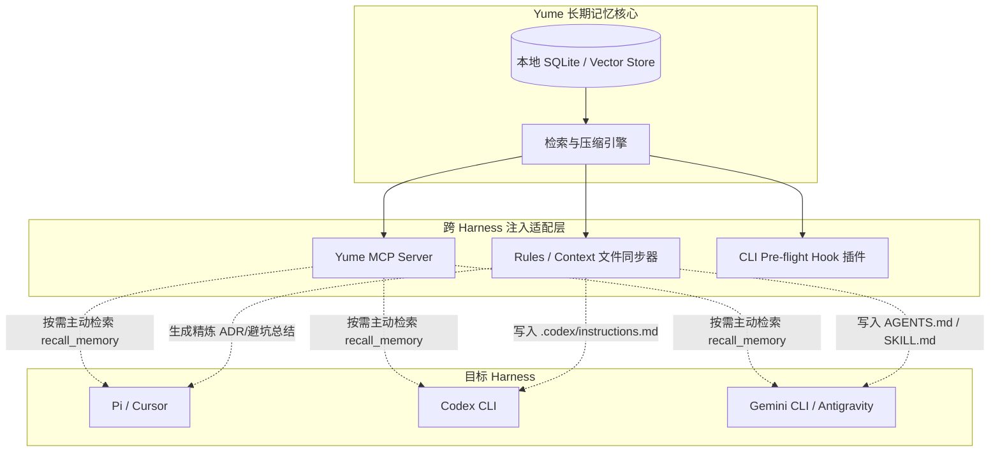

# 跨 Harness 记忆注入机制调研报告（Codex、Pi、Gemini）

> 对应 Issue: #15
> 调研目标：在多 Agent 开发环境（Codex CLI、Pi / Cursor、Gemini CLI / Antigravity）下，分析长期记忆注入的机制、契约限制与工程落地建议。

---

## 1. 调研背景与问题陈述

长期记忆系统（如 Yume）的核心价值在于跨 Session、跨任务、跨 Harness 沉淀开发者的偏好、架构决议（ADR）、排错经验和领域事实。然而，不同的 Coding Agent Harness 拥有异构的上下文装载管道、提示词体系与工具调用契约。

本调研聚焦于：
1. **注入范式**：被动注入、主动查询与启动前中间件三种模式的适用边界。
2. **目标平台契约**：OpenAI Codex、Cursor / Pi、Gemini / Antigravity 三类主流 Harness 的接入契约与硬性限制。
3. **记忆保鲜与冲突消解**：如何避免膨胀的记忆挤占推理上下文，以及与仓库静态文档（README / GLOSSARY / ADR）冲突时的仲裁机制。
4. **Yume 架构建议**：给出兼顾本地单机、低侵入与跨平台通用的记忆注入适配层接口定义。

---

## 2. 三大长期记忆注入范式对比

### 2.1 被动注入（Passive Injection）
- **实现原理**：在 Agent 启动或任务开始前，将精炼后的记忆以规则文件或 System Prompt 前缀的形式直接固化到上下文中。常见载体包括工作区内的 `AGENTS.md`、`.cursorrules`、`CLAUDE.md` 等。
- **优点**：
  - 零工具调用损耗：Agent 无需消耗额外轮次（ReAct turn）发起检索，开箱即用。
  - 跨 Harness 兼容性高：绝大多数现代 Harness 原生扫描工作区规则文件。
- **缺点**：
  - 上下文开销随记忆积累线性膨胀，容易挤占推理窗口（Token Tax）。
  - 缺乏针对具体任务的动态相关性（Irrelevant distraction），可能引入幻觉或过时约束。

### 2.2 主动查询（Active Tool / MCP Query）
- **实现原理**：通过 Model Context Protocol (MCP) 或原生 Function Calling 为 Agent 暴露显式检索工具（如 `recall_memory(query, tags, top_k)` 或 `get_architectural_context()`）。
- **优点**：
  - 按需拉取，极低的基础 Token 开销。
  - 灵活性极高：支持多跳查询与结合当前报错信息的精确排查。
- **缺点**：
  - 极度依赖 Agent 的意图判断（Intent Discovery）：Agent 可能“不知道自己需要查”，导致漏用。
  - 增加 1~2 轮交互延迟和 API 调用成本。

### 2.3 启动中间件 / 预检钩子（Pre-flight Hook / Middleware）
- **实现原理**：在 Harness 向 LLM 发送首个 Prompt 或每次 Prompt 提交前，利用 Harness 暴露的 Hook / 代理中间层（如 CLI wrapper、Extension middleware），提取任务语义向量并动态拉取 Top-K 记忆片段，临时拼接到当次调用的 System/User Context 中。
- **优点**：
  - 结合了被动注入的“无需 Agent 自觉”与主动查询的“高相关、低 Token 开销”。
- **缺点**：
  - 侵入性较高，依赖 Harness 平台是否开放 Lifecycle Hooks 或 CLI 拦截机制。

---

## 3. 目标平台契约与限制剖析

### 3.1 OpenAI Codex / Codex CLI
1. **输入通道与提示词**：
   - 支持通过 CLI 选项传递系统前缀（如 `--instructions`）。
   - 依赖本地配置与项目级指令文件（如 `.codex/instructions.md` 或标准 `AGENTS.md`）。
2. **工具与扩展能力**：
   - 原生支持 Function Calling；新版 Codex CLI 支持 MCP Client 规范。
3. **上下文与性能权衡**：
   - 典型窗口（128k ~ 200k），虽然充裕，但在高 reasoning_effort 下长系统提示会拖慢首字延迟并稀释注意力。

### 3.2 Pi / Cursor (Harness Provider / CLI)
1. **规则加载机制**：
   - 早期通过根目录 `.cursorrules`（全量加载）。
   - 现行机制演进为 `.cursor/rules/*.mdc`，支持基于 Glob pattern、文件路径或语义动态匹配规则，具备更优的颗粒度控制。
2. **MCP 支持与工具生态**：
   - 原生内置 MCP Server 宿主环境（配置位于 `.cursor/mcp.json` 或全局 settings）。
   - 支持主动暴露工具给 Agent（Composer / Chat / Agent 模式均可感知）。
3. **上下文预算与截断**：
   - 默认对系统规则有 Token 软预算，超长规则会被静默降权或截断。

### 3.3 Gemini CLI / Antigravity
1. **输入契约与生态**：
   - 支持强大的 `skills` 目录体系（基于 `SKILL.md`，带 YAML frontmatter 元数据与按需激活机制）。
   - 完备的 MCP 服务接入机制（支持 eager/lazy 动态加载模式）。
2. **超长上下文利用与权衡**：
   - 拥有百万级（1M~2M+）超长上下文窗口，支持 Prompt Caching。
   - **权衡陷阱**：虽然装得下全量记忆，但“大海捞针”（Needle in a Haystack）效应与多轮会话累积开销显著，全量倾倒会导致注意力分散与响应延迟劣化。动态语义检索与提炼注入依然必不可少。

---

## 4. 《跨 Harness 记忆注入对比表》

| 评估维度 | 被动规则注入 (AGENTS.md / rules) | 主动 MCP 协议 (Tool Pull) | 预检中间件 (Pre-flight Hook) |
| :--- | :--- | :--- | :--- |
| **主要支持平台** | Codex, Pi/Cursor, Gemini (全平台兼容) | Pi/Cursor (mcp.json), Gemini (MCP), Codex | 自建 CLI Wrapper, 部分开放 Hook 的 Harness |
| **注入通道** | 文件系统监听 / 工作区扫描 | 进程间 RPC (JSON-RPC stdio/SSE) | 进程 stdin/stdout 拦截或 SDK 中间件 |
| **实时性与保鲜** | 中（需文件写入更新） | 高（实时读取最新数据库） | 高（按请求动态召回最新片段） |
| **Token 基础预算** | 持续占用（每轮固定消耗） | 极低（仅工具 Schema 占用） | 低至中（仅注入当前意图 Top-K） |
| **Agent 依赖度** | 零依赖（强制生效） | 高依赖（需 Agent 主动发起调用） | 零依赖（自动感知并装载） |
| **生态侵入性** | 极低（标准文件） | 低（标准的开放协议） | 高（依赖 Harness 私有拦截点） |
| **实现与维护成本** | 低 | 中 | 高 |

---

## 5. 上下文开销与冲突仲裁机制

### 5.1 Token 预算与动态语义过滤
- **硬上限设置**：记忆注入总预算建议限制在单次会话 Prompt Token 的 **5% ~ 8%**（常规约 1,000 ~ 2,500 tokens），避免注意力漂移。
- **两级过滤策略**：
  1. **L1 粗筛**：根据当前打开文件、Git 分支名、用户任务 Prompt 进行向量/BM25 检索，提取 Top-N。
  2. **L2 摘要与重排**：剔除过期时效性内容，按置信度重排后以 Markdown block 格式注入。

### 5.2 权威优先级与冲突消解原则
当提取出的长期历史记忆与当前工程文件产生歧义时，应遵循严格的**权威层级（Hierarchy of Truth）**：

```
[最高权威] 代码库即时状态（当前文件源码、现有可运行测试断言）
    ↑
[规范权威] 工程静态契约（docs/adr/*.md, GLOSSARY.md, README.md）
    ↑
[会话上下文] 当前线程用户即时指示（User explicit instruction）
    ↑
[记忆参考] Yume 历史提取记忆（Historical Memory / Recall Facts）
```

> **仲裁规则**：记忆仅作为**决策先验与避坑建议**。若记忆与代码实现或 ADR 矛盾，Agent 必须以 ADR 与当前源码为准，并在 Retro 阶段将该记忆标记为 `SUPERSEDED` 或发起冲突修正。

---

## 6. Yume 记忆注入层推荐架构方案

为实现单机轻量、跨 Harness 无缝迁移并保障记忆鲜度，建议 Yume 采用 **双轨混合适配架构（Hybrid Adapter Architecture）**：



### 6.1 适配方案要点
1. **基础盘：统一 MCP Server（标准主动拉取）**
   - 暴露 `recall_facts` 与 `query_decisions` 两个原子工具，参数包含 `query: string, limit?: number`。
   - 所有兼容 MCP 的 Harness（Cursor、Gemini、Codex）均可通过配置统一接入，零协议摩擦。
2. **保底盘：轻量级 Living Rules 同步器（被动兜底）**
   - Yume 在后台每次 Dream / Retro 结算后，仅将高频关键架构原则（Top 5~10 条）自动同步至 `AGENTS.md` 的专有隔离段（使用 HTML 注释标签 `<!-- YUME_MEMORY_START --> ... <!-- YUME_MEMORY_END -->` 包裹）。
   - 保障即使不支持 MCP 的轻量 CLI 也能享有记忆红利。

### 6.2 注入层 TypeScript 接口契约定义

```typescript
export interface MemoryFact {
  id: string;
  category: 'architecture' | 'preference' | 'debugging' | 'domain';
  summary: string;
  detail: string;
  confidence: number;
  sourceSessionId: string;
  createdAt: number;
  supersededBy?: string;
}

export interface RecallQuery {
  prompt: string;
  currentFiles?: string[];
  maxTokens?: number;
  categories?: MemoryFact['category'][];
}

export interface InjectionPayload {
  passiveMarkdownSnippet: string; // 适用于 AGENTS.md 或 System Prompt
  facts: MemoryFact[];
  tokenEstimate: number;
}

export interface IMemoryInjector {
  /**
   * 提供给 MCP Server 的检索接口
   */
  recall(query: RecallQuery): Promise<InjectionPayload>;

  /**
   * 同步更新 Harness 规则文件（被动注入通道）
   */
  syncWorkspaceRules(workspaceRoot: string): Promise<void>;
}
```

---

## 7. 结论与后续演进

1. **短期交付**：优先实现 `yume mcp` 服务，暴露 `recall_facts` 工具，以最低成本兼容 Cursor 与 Gemini。
2. **中期交付**：实现 `AGENTS.md` 自动化安全插桩，提供被动兜底能力。
3. **长期探索**：探索 Harness CLI 层的 Pre-flight 语义拦截，实现完全透明的零感知无缝注入。
